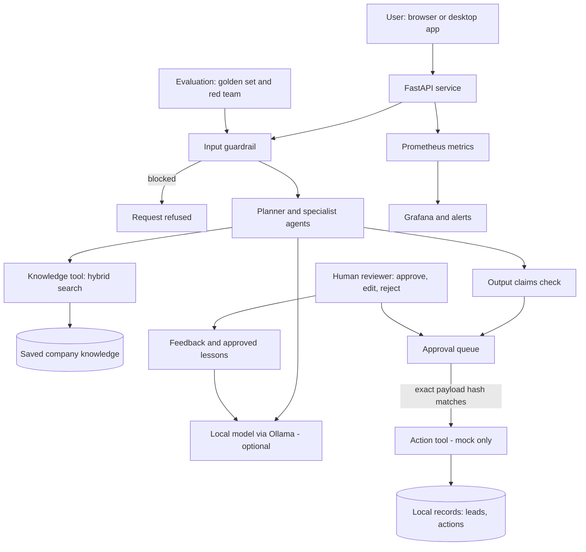

# Architecture

## Diagram

## Walkthrough of one request

1. The user saves company information (profile fields and source text). Source text is screened for injection patterns and warned about, not blocked.
2. A campaign request arrives at `/api/plan/stream`. The input guardrail checks the whole request (`guardrails.check_input`). A blocked request stops here.
3. The knowledge tool chunks the saved information, keeping source and date metadata, and runs hybrid BM25 + TF-IDF search. The top passages become cited evidence.
4. The planner builds a plan object (angle, channel plan, specialist briefs, evidence, safety flags). Progress events stream to the browser.
5. Optionally the local model produces JSON channel drafts from the plan, the evidence and approved lessons only.
6. Template drafts for each channel are checked by the output claims check.
7. Sending a draft or saving a lead creates a pending action with the exact payload and its SHA-256 hash.
8. The human approves the exact hash, edits (which changes the hash and needs new approval) or rejects. Approval of an unknown, changed, rejected or already executed action is refused.
9. An approved action runs once as a mock. Saved leads go to a local file only.
10. Feedback is stored. Only human-approved lessons guide later prompts.

## Who decides

| Decision | Made by |
|---|---|
| Whether a request is allowed | Code (regex guardrail) |
| Which passages are evidence | Code (hybrid search) |
| Draft wording | Template or local model |
| Forbidden-claim flag | Code |
| Lead score and recommendation | Code |
| Whether an action runs | Human, enforced by code |
| Whether a lesson is used | Human |

## Guide architecture mapping

| Guide box | This project |
|---|---|
| Chat UI + FastAPI streaming | Web app and `/api/plan/stream` (NDJSON). No authentication yet |
| Input / output guardrails | `guardrails.py` (rule based) |
| Supervisor and specialists (LangGraph) | `orchestrator.py`, `agents.py`: sequential, rule based, **not LangGraph** |
| MCP servers | `tools/`: plain Python functions, **not FastMCP servers** |
| Hybrid index | `retrieval.py`: BM25 + TF-IDF, no embeddings, reranker or RRF |
| Approval gate | `tools/actions.py`: hash-bound approval, **not `interrupt()`** |
| Traces, Grafana | `/metrics`, Prometheus, Grafana files (unverified) |
| Eval harness | `evaluation.py`: guardrail only |
| Improvement loop | Manual approved lessons, **no Reflexion loop** |

Redraw this diagram by hand for the final review, as the guidelines require.
